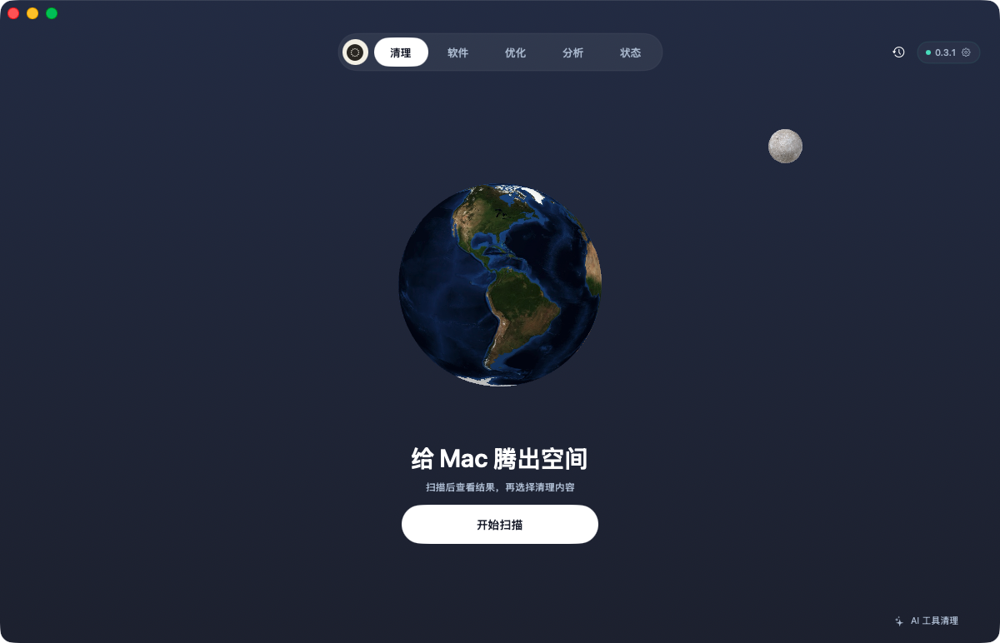

# Orbit

Orbit 是使用 SwiftUI 构建的 macOS 磁盘清理与系统监测工具，提供缓存扫描、软件管理、目录分析、系统维护和温控。扫描结果按“推荐清理”和“需要你决定”分组，每项说明用途与清理后果；普通文件移入废纸篓后可在清理记录中恢复。



## 功能

| 页面 | 功能 |
| --- | --- |
| 清理 | 应用、浏览器、通讯与开发缓存，旧安装包、项目构建产物，搜索与逐项选择，独立 AI 工具清理 |
| 软件 | 应用清单、关联数据与残留审阅、官方更新源检查、更新安装与回退、个人启动项管理 |
| 优化 | 17 项系统维护检查、DNS 与 Quick Look 操作、定时常亮、屏幕清洁模式 |
| 分析 | 目录树图、文件夹下钻、大文件列表、隐藏项、名称与大小排序 |
| 状态 | CPU、内存、交换空间、磁盘与网络、进程、电池、温度与风扇、菜单栏指标 |

运行要求为 macOS 14 或更新版本。温度传感器与风扇功能取决于硬件支持；风扇控制使用独立的管理员组件。扫描、监测与恢复可离线使用，软件更新检查需要联网。

## 下载与安装

[下载 0.4.4 DMG](https://github.com/Simonlau4/orbit-mac/releases/download/v0.4.4/Orbit-0.4.4-universal.dmg) · [ZIP](https://github.com/Simonlau4/orbit-mac/releases/download/v0.4.4/Orbit-0.4.4-universal.zip) · [版本说明与校验值](https://github.com/Simonlau4/orbit-mac/releases/tag/v0.4.4)

从 [Releases](https://github.com/Simonlau4/orbit-mac/releases) 下载 `Orbit-<版本>-universal.dmg`，打开后将 `Orbit.app` 拖入“应用程序”。也可以下载 ZIP，解压后移动应用。通用包包含 Apple Silicon（arm64）和 Intel（x86_64），要求 macOS 14 或更新版本；无需安装 Xcode 或 Swift。

当前 0.4.4 为未公证的预编译测试包，使用 ad-hoc 签名。首次打开若提示无法验证开发者，核对下载来源与下方校验值后，可按 [Apple 官方步骤](https://support.apple.com/102445)在“系统设置 → 隐私与安全性”中选择“仍要打开”。风扇控制和通过 OrbitUpdateAgent 执行的管理员更新需要开发者签名，此测试包不提供这两项能力。

在下载目录核对附件完整性：

```sh
shasum -a 256 Orbit-0.4.4-universal.dmg
```

将结果与 Release 附件 `SHA256SUMS.txt` 中对应文件的值比较。若提示应用已损坏或校验值不符，请重新下载。

## Orbit 更新提醒

0.4.4 起，Orbit 在启动时及运行中每 6 小时检查一次 GitHub Releases。有更高版本且安装包已上传时，主窗口显示更新提示，菜单栏也提供新版入口；“Orbit → 检查更新…”和设置中的“检查更新”可随时手动检查。点击“查看新版”打开本仓库的 Release 下载页，由你下载并替换应用。

检查包括已发布的数字版本测试包，不读取普通 Git 提交或草稿 Release。断网或 GitHub 限流时，自动检查不弹窗，手动检查会显示失败状态；扫描与清理仍可离线使用。

已经下载 0.4.3 的用户需要先手动安装一次 0.4.4 或更新版本，之后即可收到应用内更新提示。

### 后续发版

更新 `Resources/Info.plist` 中的 `CFBundleShortVersionString`（如 `0.4.4` → `0.4.5`）和递增的 `CFBundleVersion`，与代码一起提交并推送到 `main`。GitHub Actions 的 `Release` 工作流会运行测试、生成通用 DMG/ZIP 和校验文件，再以 `v<版本号>` 发布未公证测试包。工作流也可从 Actions 页面手动运行。

同一版本已发布时不会覆盖安装包；仅提交代码而不递增版本号，不会触发新的用户更新提示。检查使用 GitHub 的公开接口，无需用户登录或提供令牌。公开分发签名与公证仍需单独配置。

## 构建与运行

`Package.swift` 声明 Swift tools 5.9，最低运行系统为 macOS 14。构建需要包含 Swift 编译器和 macOS SDK 的 Xcode 或 Command Line Tools；编译器、SDK 应来自匹配的工具链。项目使用系统提供的 AppKit、SwiftUI、SceneKit、IOKit、CryptoKit 和 libarchive，没有第三方包依赖。

0.4.4 的验证环境：

| 项目 | 版本 |
| --- | --- |
| 构建与运行系统 | macOS 26.6.1，Apple Silicon |
| Xcode | 26.6（17F113） |
| Apple Swift | 6.3.3（swiftlang-6.3.3.1.3） |
| macOS SDK | 26.5 |

Intel 架构在此环境交叉编译，图形界面尚未进行 Intel Mac 实机验证。仅安装 Command Line Tools 的环境尚未单独验证。

```sh
git clone https://github.com/Simonlau4/orbit-mac.git
cd orbit-mac
./Scripts/build.sh
open dist/Orbit.app
```

构建产物位于 `dist/Orbit.app`，中间文件默认位于 `.build/orbit`。可通过 `ORBIT_RUNTIME` 指定构建目录。

脚本使用 `xcrun swift`，跟随 `xcode-select` 或 `DEVELOPER_DIR` 选中的工具链。需要生成通用包时，使用完整 Xcode：

```sh
./Scripts/package-release.sh
```

该命令构建 arm64 与 x86_64，验证应用签名和架构，并在 `dist` 下生成 DMG、ZIP 和 `SHA256SUMS.txt`；中间文件位于 `.build/orbit-release`。脚本只生成本地附件，不会上传或公证。

默认使用 ad-hoc 签名。启用风扇控制等需要校验开发者身份的功能时，使用本机钥匙串中的签名身份构建：

```sh
ORBIT_SIGN_IDENTITY="Apple Development: Your Name (TEAMID)" ./Scripts/build.sh
```

将应用复制到 `~/Applications` 或 `/Applications` 后即可启动。关闭窗口后仍可从菜单栏打开，退出入口也在菜单栏。

公开分发并通过 macOS 默认安全检查的版本需要 Developer ID Application 签名和 Apple 公证；Apple Development 签名用于开发测试。参见 [Apple 签名与公证说明](https://developer.apple.com/developer-id/)。

### 构建排障

遇到 `Failed to build module`、`compiled with a different version` 或 `import Foundation` 失败时，先记录完整报错并检查当前工具链：

```sh
xcode-select -p
xcrun --find swift
xcrun swift --version
xcrun --sdk macosx --show-sdk-path
xcrun swift -e 'import Foundation; print("Foundation OK")'
```

若最小 Foundation 检查也失败，应先排查工具链、SDK 和模块缓存；仅凭 Swift 构建号尾数不同，无法确认是系统目录中的旧模块残留。

1. 已安装完整 Xcode 时，可只为本次构建选择它，避免改变系统全局配置：

   ```sh
   DEVELOPER_DIR=/Applications/Xcode.app/Contents/Developer ./Scripts/build.sh
   ```

   若终端设置过 `SDKROOT` 或 `TOOLCHAINS`，检查它们是否指向其他版本；移除这些覆盖后重试。

2. 尚未安装开发工具时运行 `xcode-select --install`。已安装 Command Line Tools 时，通过“系统设置 → 通用 → 软件更新”更新，或从 [Apple Developer Downloads](https://developer.apple.com/download/more/) 安装与当前 macOS 匹配的版本。更新方式见 [Apple 官方说明](https://developer.apple.com/documentation/xcode/installing-the-command-line-tools/)。

3. 工具链已匹配但仍有旧构建缓存报错时，使用新的项目构建目录重试：

   ```sh
   ORBIT_RUNTIME="$(mktemp -d "${TMPDIR:-/tmp}/orbit-build.XXXXXX")" ./Scripts/build.sh
   ```

以上步骤不需要删除 `/Library/Developer/CommandLineTools` 或修改 SDK 内部文件。仍失败时，请在 Issue 中附上完整错误及上述环境输出。

## 清理与恢复

1. 扫描后审阅结果。“推荐清理”中的可重建缓存、日志和软件包下载默认勾选；旧安装包、构建产物和应用旧更新包位于“需要你决定”，默认不选。
2. 调整选择，点击“移入废纸篓”并确认。可搜索项目，或打开“逐个文件查看”按文件选择。
3. 点击右上角时钟图标打开清理记录，逐项恢复。恢复时保留已有同名文件。

运行中应用的缓存与近期缓存按规则保留。项目构建产物需要至少 7 天无改动且没有进程在项目中工作；移动前会重新核对。AI 对话、记忆、技能、模型与工具程序包在 AI 清理入口单独审阅。

系统数据、已有废纸篓、数据库、离线内容和归属未核实的数据只统计占用。权限不足或扫描达到预算时会显示部分覆盖；“读取权限”提供检测与 macOS 设置入口。修改扫描范围后需重新扫描。

移入废纸篓后仍占磁盘空间，清空后才释放。恢复依赖废纸篓中的文件及对应记录；AI、维护和程序包操作使用独立恢复副本。

## 软件管理与维护

应用卸载与残留清理先展示关联文件，再按选择执行。个人 `~/Library/LaunchAgents` 支持停用与恢复，系统启动项可在系统设置中管理。

软件更新读取应用声明的 HTTPS Sparkle 更新源，核对签名、开发者、应用标识和版本。ZIP/DMG 更新保留旧版以便恢复；PKG 交给系统安装器。自动更新等待应用退出后安装，需要管理员权限的安装由用户确认并完成系统认证。

系统维护先检查与预览，再按选择执行。风扇控制提供自动、降温和强冷模式；租约失效、睡眠、退出或达到 30 分钟上限时恢复自动控制。

## 快捷键

| 快捷键 | 操作 |
| --- | --- |
| ⌘1–⌘5 | 切换页面 |
| ⌘F | 搜索当前结果或应用 |
| ⌘R | 扫描 |
| ⌘⇧H | 打开清理记录 |
| ⌘, | 打开设置 |
| Esc | 关闭弹窗或退出屏幕清洁模式 |

文件行右键菜单可在 Finder 中显示项目或拷贝路径。设置支持清理类别、近期缓存、监测频率与菜单栏指标。

## 测试

```sh
xcrun swift test --scratch-path .build/orbit/build
```

测试使用独立 fixture，覆盖扫描范围、选择策略、文件变化、恢复冲突、更新安装、启动项与管理员组件校验。

原生界面检查可使用自建目录生成截图：

```sh
open -n dist/Orbit.app --args --ui-smoke /absolute/path/to/screenshots --disk-fixture /absolute/path/to/fixture
```

该检查依次打开五个页面、分析指定目录并执行只读扫描。SceneKit 的 Metal 图层需使用原生窗口截图检查。

## 项目结构

- `Sources/Orbit`：SwiftUI 界面与应用状态。
- `Sources/OrbitCore`：扫描、恢复、系统监测与维护。
- `Sources/OrbitFanAgent`：温控管理员组件。
- `Sources/OrbitUpdateAgent`：软件更新管理员组件。
- `Tests`：核心与应用层测试。
- `Scripts`、`Resources`：构建脚本、图标与应用配置。

[功能说明](docs/feature-parity.md) · [扫描范围与计量](docs/scan-differences.md) · [开发说明](AGENTS.md) · [影像来源](Sources/Orbit/Assets/CREDITS.md)
